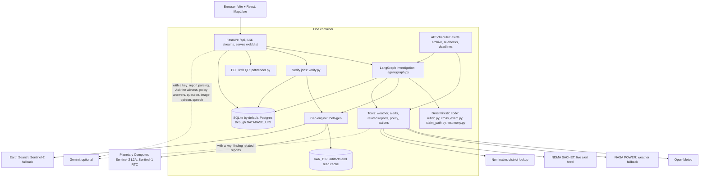
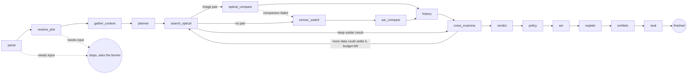

# FasalSaakshi (फसल साक्षी, "crop witness")

A field's own satellite record of a specific crop loss, tested against look-alike fields, cross-examined, and recomputable by anyone from public archives.

Forge '26 Gen AI Buildathon. Theme 2, Problem 2.

- **Live app:** https://exercise-instance-promptly-proxy.trycloudflare.com
- **Demo video:** https://drive.google.com/file/d/1Tt_5LF6CzvONoBqgDpttNTY_Go2xSDd1/view?usp=sharing

> **Read before trusting any result.** There is no plot-level ground truth for any event here. The evidence shows consistency, not accuracy. Sensitivity via the field-signal test is shown only on the event the method was designed on. Radar does not confirm the Bhiwani hail band. No Cyclone Arnab signal is established. None of the Gemini features has been run against the real API. See [Limitations](#limitations).

## What it is, and who it is for

A farmer in India reports a loss, in Hindi, Telugu or English, and outlines the field on a map. The app then:

1. Finds Sentinel-2 and Sentinel-1 passes for that plot, and throws out bad scenes.
2. Asks whether the field changed more than look-alike fields: fields outside the storm area, and its immediate neighbours.
3. Attacks its own evidence with nine objections from a hostile surveyor. It can concede.
4. Gives a verdict from a fixed rubric, and works out which PMFBY route applies, with cited clauses.
5. Seals the numbers with a hash. A QR code on the PDF opens a page that downloads the same scenes again and recomputes them.

**For:** PMFBY-insured farmers, and the people who help them (bank staff, agriculture officers, FPOs, KVKs).

**It is not** a claim decision, an insurer tool, a yield estimate, or proof of cause. It never files anything. It records a filing only when the farmer enters a reference number. No clause in the guidelines provides for farmer-submitted satellite evidence, and an insurer may decline to look at it.

## How Gen AI is used

**Gemini understands, explains and questions. Code measures and decides. A model can't talk the verdict up.**

| Feature | What Gemini does | What holds it back | Without Gemini |
|---|---|---|---|
| Understands the report | Turns Hindi, Telugu and Hinglish voice or text into structured facts, and asks a clarifying question if the report is ambiguous | The question passes the validator and changes no field. The farmer confirms every fact | Keyword parser, typed text or the browser's speech recognition |
| Ask the witness (`agent/witness.py`) | Answers a farmer's question about their own result, in their language | It sees only an allow-listed copy of that case's record and the retrieved clauses. An answer is shown only if it cites the fields or clauses it used, and passes the digit check and phrase denylist. It refuses what the record doesn't cover | Suggested questions get the record's fixed words, rule questions get retrieved clauses, and anything else gets a refusal |
| Contradiction question (`agent/advisory.py`) | Compares the statement with the evidence on date, event and crop stage, and asks one question | It's only a question. A new date or event counts only if the check is run again, and the seal stays as it is | "Not available" |
| Second opinion on images (`agent/advisory.py`) | Reads the before and after images | Labelled advisory, and never fed to the rubric. A disagreement shows as "needs a person to look" and changes nothing | "Not available" |
| Speech | Reads the testimony aloud | Reads deterministic text | Browser speech |
| Related reports | Finds them through grounded search | Shown beside the result. They never change a level | Skipped |

**Why the verdict stays off the LLM.** The same evidence has to give the same level, or nothing here can be reproduced. A sealed result has to be checkable by someone who doesn't trust us or a model. And a model asked to help a farmer can talk a weak result up. So the rubric reads measured values only. Advisory output is stored beside the record, outside the sealed core, and the rubric never reads it. Verdict, explanation, testimony and cross-examination text are deterministic templates.

**None of this has been run against the real API.** Tests use stubs and fakes, and the running app reports `gemini: false`. To test it with a key:

```bash
cd backend && uv run python -m app.agent.llm --selftest
docker exec -it fasalsaakshi .venv/bin/python -m app.agent.llm --selftest   # in the deployed container
```

Live checks on the deployed app, 1 Nov 2026: report parsing, Ask the witness (English and Hindi, including a refusal), the image second opinion and speech all answered through Gemini 3.6 Flash and Gemini 3.8 Flash-Lite TTS. Gemini 3.8 Flash and 3.1 Pro returned quota errors on our key, so the models are set by environment variable.

## Architecture

One container. FastAPI serves the built Vite + React app and the API from one URL.



Branching is an explicit state graph, written in code. The verdict and its text are deterministic. The investigation graph, as built in `build_graph` in `backend/app/agent/graph.py`:



The `planner` node takes the default path. `LLM_PLANNER=true` would let the LLM choose radar instead, and it is off by default. Budget: 12 counted tool calls, a 150 s soft limit, and a 600 s hard limit for exhibits. Radar and history start in the background. The verdict does not wait for them past a 75 s target. Village, scale fade, chips and timeline run after the verdict and fill in live. The hash is sealed once they settle. If late evidence changes the outcome, the verdict is revised and the trace says so.

## Setup

Needs Python 3.12, [uv](https://docs.astral.sh/uv/), Node 22, and Pango for WeasyPrint on the host (the Dockerfile lists the packages).

```bash
cd backend
uv sync
cp .env.example .env     # every value is optional for a local run

cd ../web
npm ci
npm run build            # FastAPI serves web/dist
```

### Environment variables (`backend/.env.example`)

| Variable | Required | Purpose |
|---|---|---|
| `GEMINI_API_KEY` | No | Turns on the optional LLM features. Without it the verdict, cross-examination and templated text still run, with `llm_used: false`. |
| `LLM_POLISH` | No | Default `false`. `true` lets the LLM rewrite the narrative, testimony and surveyor's challenges, through the validator. |
| `LLM_PLANNER` | No | Default `false`. `true` lets the LLM choose the initial search step. That can move which images are read, and so the level, which is why it is off. |
| `GEMINI_MODEL_PRO`, `GEMINI_MODEL_FLASH`, `GEMINI_MODEL_TTS`, `GEMINI_MODEL_EMBED` | No | Model ids. Defaults are in the example file. |
| `PUBLIC_WEB_URL` | For a deploy | Base URL printed in the PDF's QR code and the draft's verify link. Unset, they use each request's own origin, and a warning is logged at startup. |
| `TRUST_PROXY` | Behind a proxy | Default `false`. `true` takes the client IP from `X-Forwarded-For` and the origin from `X-Forwarded-Host` and `X-Forwarded-Proto`. Only set it when a proxy you control sets those headers. |
| `RATE_INVESTIGATIONS_PER_HOUR`, `RATE_VERIFY_PER_HOUR`, `RATE_ASKS_PER_HOUR`, `RATE_CASES_PER_HOUR`, `RATE_PDF_RENDERS_PER_HOUR` | No | Per-IP limits, held in process. Defaults 12, 3, 60, 60, 60. Only a new verify download or PDF render counts. Run one process: no `--workers`. |
| `MAX_QUEUED_RUNS` | No | Default 8. Past this, a new investigation gets a 429 with a message in each language. |
| `DATABASE_URL` | No | Defaults to SQLite in `VAR_DIR`. Accepts Postgres. |
| `OPEN_METEO_API_KEY` | No | Uses Open-Meteo's customer endpoints. |
| `PC_SDK_SUBSCRIPTION_KEY` | No | Planetary Computer subscription key. |
| `SCHEDULER_TOKEN` | To use the route | `POST /api/jobs/tick` needs this in `X-Scheduler-Token`, and is refused for everyone while it is unset. Use a long random value, such as `openssl rand -hex 32`. The in-process scheduler does not need it. |

Other settings are in `backend/app/config.py`, including `VAR_DIR` and `ENABLE_SCHEDULER`. Never commit secrets.

## Run

**Local:**

```bash
cd backend
uv run uvicorn app.main:app --port 8000
# open http://localhost:8000
```

For front-end work, also run `npm run dev` in `web/`. It serves on port 5173 and proxies `/api` to port 8000.

**Container:**

```bash
docker build -t fasalsaakshi .
docker run -p 8080:8080 \
  -v fasalsaakshi-data:/data \
  -e PUBLIC_WEB_URL=https://your-host.example \
  -e GEMINI_API_KEY=... \
  fasalsaakshi
# open http://localhost:8080
```

Mount a persistent volume at `/data`. The sealed records behind every QR link live there. The image holds no cases, because the app ships with no seeded data. Each deployment starts empty.

**To host it, follow [deploy/README.md](deploy/README.md):** a VM in the Netherlands or West Europe, one process, a permanent disk, and `backend/scripts/warm_demo.py` after every deploy. Planetary Computer's Sentinel blobs are served from Amsterdam, and read time dominates a cold run.

## Tests

```bash
cd backend
uv run pytest -m "not live"              # offline, real network blocked
uv run pytest -m live tests/test_geo_live.py   # real archives, slow

cd ../web
npm run typecheck
npm run test:e2e                         # needs the app running; see web/playwright.config.ts
REAL=1 npm run test:e2e                  # also runs the real end-to-end path, real satellite data
```

Our own last runs gave 684 backend tests passed, with 6 live tests deselected, and 75 mocked UI tests passed. The mocked UI run needs the dev server (`npm run dev`). Plain `uv run pytest` would include the live tests, so pass the marker. Test fixtures live in `backend/tests/` only.

`backend/tests/geo_*.py` are validation scripts on real data, not pytest tests.

## The evidence method

**Statistic.** Median NDVI change over the polygon, between the last accepted scene before the event and the earliest accepted scene at least 5 days after it. If none exists that late, the earliest accepted scene is used, the verdict says it may be too early, and a re-check is scheduled.

**Scene QA.** Every scene passes radiometric checks before any index is used. Metadata cloud cover is not trusted. The 28 Oct 2026 pass over Sirsa has about 0% metadata cloud and is rejected for impossible reflectance ([engine-results section 1](docs/validation/engine-results.md#1-scene-qa-regression)).

**Two questions.** Both are placebo tests: same-shape pseudo-plots placed on comparable pixels (pre-event NDVI within 0.15 and IQR within 0.05 of the plot's), up to 200 per test, with p = (k + 1) / (n + 1).

| Test | Question | Placebos | What it tells you |
|---|---|---|---|
| **Far** | Did this field change more than comparable fields outside the storm area? | 5-12 km away | Detects the event |
| **Ring** | Did it change more than its immediate neighbours? | 300 m to 1.5 km from the plot edge | Describes how local the loss is |

A ring test has low power inside a swath, because the ring shares the damage. That finding is why the far test exists. "Far yes, ring no" reads as "the effect does not look limited to your field". For an event wider than 12 km the far test loses power too, and history and the pre-event trend carry the case.

**Near the threshold.** Thresholds do not move, but a deciding p-value from 0.01 to 0.075 is reported as near the threshold, with the caveat "a slightly different drawing of this field could change this result". The seed comes from the polygon and event date, so the same record reproduces exactly, while a slightly different polygon or date re-samples. On 30 seeds, far p moved by a factor of about 4-8 near 0.025 ([section 7a](docs/validation/engine-results.md#7a-seed-sensitivity-geo_seed_sensitivitypy)).

**Cross-examination.** Nine objections, each answered by a test on real values: harvest, wrong plot, wrong date, cloud or shadow, corrupt scene, regional trend, pre-event trend, plot too small, different crop in past years. Each ends `rebutted`, `conceded` or `unresolved`. A concession that more data could settle sends the graph back to search, within budget. Code: `backend/app/agent/cross_exam.py`.

**Verdict rubric v3** (`backend/app/agent/rubric.py`), evaluated top to bottom. Field signal = far p ≤ 0.025 or ring p ≤ 0.025 (Bonferroni across two tests), each on at least 30 placebos. Corroborated = model weather, or an official alert whose hazard matches the reported event. Cited news appears as related reports and never changes a level, because search hits carry no reliable date, place or peril check. Absence of a weather signal never counts against the farmer, but a report with neither stays `weak`, and the text says why.

| Level | Conditions |
|---|---|
| `not_damage_likely_harvest` | Harvest objection conceded |
| `insufficient` | No accepted optical post scene and no usable radar pair, or too few placebos and no other signal |
| `weak` | No crop visible before the event (pre NDVI below 0.3) |
| `strong` | Accepted optical pair, change ≤ -0.15, field signal, corroborated, no objection conceded |
| `moderate` | Corroborated, and one of: change ≤ -0.10 with a field signal; radar placebo p ≤ 0.05; new water ≥ 0.2 of the plot |
| `weak` | Anything else |

Radar alone can reach moderate at most.

**Replayable verification.** The hash is SHA-256 over canonical JSON of `ReplayCore`: polygon, event date, scene ids, the archive of each scene, seed, engine version, and the flat numbers (104 on a record with radar, 85 without). `/verify/{hash}` checks the hash against the stored record, which detects tampering, and then re-downloads the scenes with caches bypassed. Each number is compared with the sealed value, with a tolerance of 0.001. The core also holds `verdict_digest`, a SHA-256 of the verdict level and its corroboration inputs (weather values used, matched alert ids). **Satellite numbers are recomputed; the verdict and weather are checked for tampering only.** The explanation text, claim route and related reports are not sealed. When two cases share a hash, the most recent is used. Public verify output never carries a case id.

**Other exhibits.**
- *The Field Testifies:* the evidence told by the field itself, from a template over real values, with the verdict's caveats.
- *The storm's footprint:* the change map across about 24 km. A band on it is labelled consistent with the event, not proof of cause.
- *The Vanishing:* the same change averaged in blocks from 10 m to 3 km. Our illustration from public satellite data, not output of YES-TECH.
- *The Ten-Field Draw:* para 21.5.8's sample of 10 random parcels, simulated 1000 times with a fixed seed, on two pools (all cropland, and only fields that visibly dropped). It draws from cropland, not the real intimation list. It uses a satellite index, not assessed loss. Its share is an indicator, not the legal 25% test. Random sampling is unbiased on average, and the Draw does not say the rule is unfair.

**Claim path** (`backend/app/agent/claim_path.py`). Routes by insured status, crop stage, peril and crop before any deadline appears. The 72-hour countdown shows only on the localized and post-harvest add-on routes, and only while the time is open. State notification is always treated as unknown: "confirm with your bank or 14447". Rule text and clause ids are in `backend/data/policy/`.

**The LLM cannot change a number or a level** (see [How Gen AI is used](#how-gen-ai-is-used)). The verdict, explanation, testimony and cross-examination come from deterministic templates in Hindi, English and Telugu. `LLM_POLISH=true` turns on rewrites of those, and `LLM_PLANNER=true` the LLM planner; both are off by default, so the same evidence gives the same level with or without an LLM. All LLM text passes `backend/app/agent/validate.py`. Every digit sequence must exist in the evidence, and banned claims and spelled-out percentages are blocked. Otherwise the deterministic template is used.

## Data sources

| Source | Used for | Notes |
|---|---|---|
| Sentinel-2 L2A, Microsoft Planetary Computer | Optical comparison, QA, history, timeline | Primary archive |
| Sentinel-2 L2A, Earth Search (`earth-search.aws.element84.com/v1`) | Recent passes Planetary Computer has not ingested | Offset handled from the archive's flag ([section 4](docs/validation/engine-results.md#earth-search-fallback)) |
| Sentinel-1 RTC, Planetary Computer | Radar comparison, new water | Same relative orbit and pass direction only |
| Open-Meteo historical forecast API | Model-indicated rain, weather codes, gusts | A gridded model of about 9-25 km, not a gauge |
| NASA POWER | Weather fallback | No hail codes |
| NDMA SACHET | Official alerts | The feed carries current alerts only, so the archive starts when archiving starts |
| OpenStreetMap Nominatim | District lookup | |
| PMFBY Operational Guidelines 2023, PIB, Lok Sabha replies | Claim path and policy answers | `backend/data/policy/`, sources in `docs/submission/facts.md` |
| Gemini (optional) | Report parsing, witness answers and policy answers under validation, the statement question, an advisory read of the images, related reports through Search grounding, TTS, embeddings; narrative polish only under `LLM_POLISH=true` | Not verified. See Limitations |

ESA WorldCover 2021 was used to sample validation plots only. It is not in the running engine.

## Validation

Engine numbers below come from [docs/validation/engine-results.md](docs/validation/engine-results.md) or from the final sealed records, read through the live API. Records are on engine `geo-1.2.0`. The locked runs used `geo-1.1.0`, whose numbers are byte-identical on both Bhiwani demo plots ([section 8](docs/validation/engine-results.md#8-read-time)). There is no plot-level ground truth for any of these events, so this work shows consistency, not accuracy.

### Locked runs

Rules were frozen before these ran. Each ran once and is reported as it came out, with no retuning. "Field conditions" means the rubric's plot rule without corroboration. The rubric's actual `strong` and `moderate` also need corroboration.

| Run | Result | Read it with this |
|---|---|---|
| No event, Oct 2025, near 29.40 N 75.45 E, 200 plots | Strong field conditions 2.0% (CI 0.8-5.0). Moderate 2.5% (CI 1.1-5.7) | One scene pair with correlated plots, so the CIs are too narrow. "No event" means none reported in our sources. Far p-values lean slightly low here, so the far test may be slightly liberal |
| No event, Mar 2025, Bhiwani region, 200 plots | Strong field conditions 2.0% (CI 0.8-5.0). Moderate 2.5% (CI 1.1-5.7) | Same limits. We did not search exhaustively for March 2025 events around Bhiwani |
| Independent event: Sirsa hail, 14 Mar 2025, 200 plots | 0 of 200 (CI 0.0-1.9) | **Not a pass.** The Tribune called the damage "minor", so no signal is consistent with the report, but we cannot tell little damage from a miss |
| Pre-registered independent positive test: Punjab floods, Aug 2025, 60 plots against 2024 | **Partial.** New water at least 0.2 of the plot: 28.3% against 0.0%, passes. SAR placebo p ≤ 0.05: 1.7% against 8.3%, fails | The pair rule picked different timing in the two years, so the 2024 control does not sample early September and its 0.0% may be cleaner than a same-dates comparison. One site of three shows almost nothing (Pakhoke Mehmaran, 5%). The placebo missed it because the ring flooded too, and radar has no far test |
| Seed sensitivity, 7 plots, 30 seeds each | Clear cases are stable: far p on the strongest plot is 0.005 on all 30. Near 0.025, far p moves by a factor of about 4-8, and the level flips on up to a third of seeds | Five of the seven were picked for being near the line, so that is the worst case. Thresholds were not changed; near-threshold results carry a caveat |

**Sensitivity via the field-signal test is shown only on Bhiwani, the design event.** That is the main thing this validation does not establish. Details: [section 7](docs/validation/engine-results.md#7-locked-runs), [7a](docs/validation/engine-results.md#7a-seed-sensitivity-geo_seed_sensitivitypy), [7b](docs/validation/engine-results.md#7b-punjab-floods-august-2025-pre-registered-independent-positive-test).

### Final sealed records (live API)

| Record | Verdict | Numbers | Full check |
|---|---|---|---|
| **Strongest of 200 scanned**, Bhiwani. Case `1ce7e64b754248abb18f0d29ac6203eb`, hash `6092fe1c9ef1…` | `strong` | Change -0.3689. Far p 0.005 (0 of 200). Ring p 0.0597 (11 of 200). Radar p 0.6617, and the verdict says optical and radar disagree. Vanishing -0.3689 to -0.0983. Draw -0.080 and -0.239 | 104 of 104 |
| **Typical, median of the original 40**, Bhiwani. Case `c157d2d75ce94501ad08930624a10e76`, hash `56aadcb68360…` | `weak`, near the threshold | Change -0.1259. Far p 0.039 (7 of 204). Ring p 0.1859 (28 of 155). Vanishing -0.1259 to -0.0811. Draw -0.0653 and -0.2309 | 104 of 104 |
| **Arnab, strongest of 51 usable plots** near Anaparthi. Case `3ea2ca9c8ef14a05af4a407ab4003230`, hash `17a3b0d203d5…` | `weak`, near the threshold | Change -0.3419 in 5 days, 3 days after landfall. Far p 0.0292 (3 of 136). Ring p 0.0945 (18 of 200). No radar pair. Same plot in other years: -0.2013 and -0.2388 over longer windows | 85 of 85 |

Independent runs from a clean database produced identical hashes for these records.

**Typical plot, disclosed.** It is the median of the original 40 in-band plots, drawn without the pre-event NDVI filter we intended. With the filter, the median is 28.710543 N, 76.228524 E, at -0.1283 ([section 3e](docs/validation/engine-results.md#3e-distribution-across-in-band-plots-geo_band_distributionpy)).

**Arnab, disclosed.** No signal is established, and a later pass will help. The crop was days from harvest. On this plot, the scan on tile 44QND read -0.3595 with far p 0.0049 and ring p 0.005. The sealed record reads the same pass on tile 44QPD and gets -0.3419, far p 0.0292 and ring p 0.0945. Sen2Cor corrects each tile separately ([section 4](docs/validation/engine-results.md#4-cyclone-arnab)).

### Other checks

| Check | Result | Where |
|---|---|---|
| Corrupt scene with about 0% metadata cloud | Rejected | [Section 1](docs/validation/engine-results.md#1-scene-qa-regression) |
| Design window, Sirsa, Oct 2025, 299 plots, ring test | p ≤ 0.05: 5.0% (CI 3.1-8.1). p ≤ 0.10: 15.4% (CI 11.7-19.9), above nominal, so that tier was removed | [Section 2](docs/validation/engine-results.md#2-false-positive-rate-design-window) |
| Bhiwani, hail of 2-3 March 2024, other-year controls | A coherent band, consistent with a hail swath. Band minus far contrast: -0.146 in 2024 (mask defined on this pair, so inflated by selection), +0.008 before the hail, and +0.007 to +0.052 in 2022, 2023 and 2025 | [Section 3c](docs/validation/engine-results.md#3c-attacking-the-band-geo_c1_controlspy) |
| Radar on that band | **Does not confirm it.** VH contrast is +0.50 dB ascending and -0.47 dB descending. The orbits disagree | Section 3c |
| 40 random in-band plots, no pre-event filter | Median change -0.125. 85% moved at least -0.10, 32.5% at least -0.15. Draw medians -0.069 and -0.245, which are bounds, not an estimate | Section 3e |
| Cyclone Arnab, tile scale | About -0.1 is the normal drop for these weeks. One optical scene after landfall, next usable radar about 4 Nov | Section 4 |
| Sirsa and Fatehabad, 24 Oct 2026 | No signal established on either named village. No usable optical after the storm yet | Section 5 |

### Time

Measured on the development machine, on a slow link shared with other jobs ([section 8](docs/validation/engine-results.md#8-read-time)). Hosted timing: not yet measured.

| Step | Time |
|---|---|
| Verdict, warm data | 10 to 20 s |
| Verdict, a warm run with part of the data cached | About 70-75 s |
| Verify: the field's own 20 numbers | 31 to 41 s across the three records |
| Verify: a full check, re-downloaded | 395 s and 338 s (104 numbers), 281 s (85 numbers) |

The 90 s cold target is not met from this machine. In the built container, on an empty disk and a pin never run before (Kirtan, Hisar), on this link of about 0.39 MB/s: earliest provisional result at 75 s, everything sealed at 497 s, about 1 GB of memory, and a 552 KB PDF. Section 8 has tool-by-tool cold times.

## Limitations

**Evidence**

- **No ground truth.** News and official reports give villages and district-level loss bins. Nobody has checked these fields. This shows consistency, not accuracy.
- **Sensitivity is shown only on the design event.** Rubric v3's field conditions fired on 2.0% (strong) and 2.5% (moderate) of plots on two no-event windows, but the independent hail event gave 0 of 200, which we cannot tell from a miss. Punjab's pre-registered flood test was partial: new water passed, the radar placebo failed.
- **Near the line, the seed can decide.** A slightly different polygon or date re-samples. Near 0.025, the level flips on up to a third of seeds. Those results carry a visible caveat.
- **The method was shaped by the data.** The far test and the post-scene rule were designed after seeing Bhiwani. The 0.025 thresholds were set after seeing Sirsa 2025.
- **Selection.** The most dramatic plot is the strongest of 200 scanned and is labelled so. A typical in-band plot (the median of the original 40) is far weaker, and its verdict is `weak`.
- **Radar does not confirm the Bhiwani band.** The orbits disagree. That is a real miss.
- **Hail is not established.** The band is consistent with a hail swath. A crop pattern specific to 2024 cannot be ruled out, as we have no crop-type or field data.
- **Bhiwani is a signal case, not a PMFBY claim case.** A Congress leader said no insurer covered Hisar that season.
- **No Arnab signal is established.** The sealed plot is the strongest of 51 usable, was days from harvest, and also fell in other years. A later pass will help. This does not contradict reports of flattened paddy, as lodged paddy can stay green. The same pass can read differently on two Sentinel-2 tiles, and the verdict on this plot differs with the tile.
- **Ripening.** Near harvest, a fall in greenness can be ripening. Bare soil cannot settle that, and the cross-examination reports it as unresolved unless the field's own past years do.
- **Weather is a model.** Gridded weather can miss a hail cell. It can also corroborate on rain alone: the sealed Bhiwani records have 18.4 mm in a day and zero hail-code hours. Corroboration is the weather model or an official alert matching the event. News never changes a level. A report with neither stays `weak`, even if the hail was real.
- **Comparable cropland means pre-event NDVI and uniformity.** There is no land-cover map inside the engine. Thin haze can pass QA. Validation squares cross field boundaries, while real plots follow one field.
- **Sentinel-2's 10 m pixels are coarse for small plots.** Under 0.2 ha the app says so and asks for photographs. We do not claim a better sensor than YES-TECH. Our difference is the unit of analysis and the placebo test.

**Exhibits**

- **The Draw and the Vanishing are illustrations.** They are not survey results or YES-TECH output. Vanishing blocks are centred on the plot, the kindest alignment for it. We show no rupee figures. Para 21.5.8 may not govern a given case, and the app labels it as illustration where it does not apply.

**Policy**

- **Insurer acceptance is not assured.** The honest hook is that the insurer collects "any other available evidence" (para 21.5.6.2).
- **State notification is unknown.** We have not verified any State's add-on notification, including Andhra Pradesh's for paddy. We name no AP insurer. Paddy localized inundation for Kharif 2026 is officially contradicted, and the app does not say it is covered.
- **The guidelines text is OG 2023,** the latest we could find. Later circulars may exist. Helpline numbers are as published and were not test-called.

**Not verified**

- **Gemini paths:** parsing voice and text, witness and policy answers under validation, the statement question, the second opinion on images, speech, and finding related reports. Tests use stubs and fakes, and the running app reports `gemini: false`. All of these stay unverified until a key is tested (`deploy/README.md` has the self-test). The model ids are from a docs page and have not been called. Hindi TTS support was not stated on that page. `LLM_POLISH` and `LLM_PLANNER` are off by default. Without a key, the search for related reports is skipped and the level does not change, audio needs the browser's own speech recognition or typed text, and spoken output uses browser speech.
- **Telugu text** has not been reviewed by a native speaker.
- **Postgres** is accepted through `DATABASE_URL`, but this repo's tests run on SQLite.
- **Hosted performance.** All timings above are from one development machine on a slow link. There is no load test. Runs, rate limits and the scheduler live in one process, so this is one instance, not a cluster.
- **Field use.** The repo records no trial with farmers, surveyors or insurers.

**Verification limits**

- **"Verified" covers satellite numbers only.** They are recomputed. The verdict and weather are checked for tampering only, through a digest in the seal.
- It proves the numbers follow from the public scenes and this code. It does not prove the cause, or that the damage is real.
- It depends on the archives keeping the same scenes. An outage is reported as an outage, never as a mismatch.
- A full check is slow on a thin link. A repeat scan shows the last full check, labelled with its time, and a re-run has to be asked for.

## Repository map

```
backend/app/agent/       graph, rubric, cross-examination, claim path, explanation, testimony, validator
backend/app/tools/geo/   the satellite engine: search, QA, compare, placebo, far, twin, village, scale, replay
backend/app/tools/       weather, alerts, news, policy, actions
backend/app/verify.py    public recomputation
backend/scripts/         warm_demo.py, real demo cases through the public API
deploy/                  hosting guide and VM script
backend/app/pdf/         evidence PDF with QR code
backend/data/policy/     cited rule text
backend/tests/           pytest suite, and geo_*.py validation scripts
web/src/                 Vite + React app
docs/validation/         measured results and verified events
docs/submission/         fact sheet, demo script, form text, deck content
docs/TEAM_WALKTHROUGH.md guided tour of the code and the method
docs/plan/07-build-contract.md  the contract; it overrides older plan and ideation files
```

Older files in `docs/plan`, `docs/ideation` and `HACKATHON_PLAYBOOK.md` hold superseded claims and are kept as history. For external numbers, use `docs/submission/facts.md` only.
