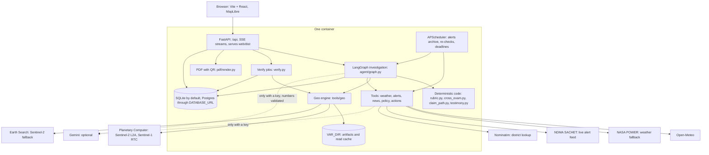
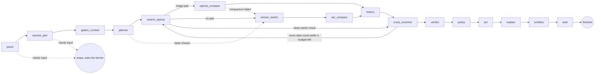

# FasalSaakshi (फसल साक्षी, "crop witness")

A field's own satellite record of a specific crop loss, tested against look-alike fields, cross-examined, and recomputable by anyone from public archives.

Forge '26 Gen AI Buildathon. Theme 2, Problem 2.

- **Live app:** `TODO(deploy)`
- **Demo video:** `TODO(video)`

> **Read before trusting any result.** There is no plot-level ground truth for any event here. The evidence shows consistency, not accuracy. Rubric v3's false-positive rate is still pending. Radar does not confirm the Bhiwani hail band. No Cyclone Arnab signal is established. Gemini paths have not been run against the real API. See [Limitations](#limitations).

## What it is, and who it is for

A farmer in India reports a loss, in Hindi, Telugu or English, and outlines the field on a map. The app then:

1. Finds Sentinel-2 and Sentinel-1 passes for that plot, and throws out bad scenes.
2. Asks whether the field changed more than look-alike fields: fields outside the storm area, and its immediate neighbours.
3. Attacks its own evidence with nine objections from a hostile surveyor. It can concede.
4. Gives a verdict from a fixed rubric, and works out which PMFBY route applies, with cited clauses.
5. Seals the numbers with a hash. A QR code on the PDF opens a page that downloads the same scenes again and recomputes them.

**For:** PMFBY-insured farmers, and the people who help them (bank staff, agriculture officers, FPOs, KVKs).

**It is not** a claim decision, an insurer tool, a yield estimate, or proof of cause. It never files anything. It records a filing only when the farmer enters a reference number. No clause in the guidelines provides for farmer-submitted satellite evidence, and an insurer may decline to look at it.

## Architecture

One container. FastAPI serves the built Vite + React app and the API from one URL.



The investigation graph, as built in `build_graph` in `backend/app/agent/graph.py`:



Budget: 12 counted tool calls, a 150 s soft limit, and a 600 s hard limit for exhibits. Radar and history start in the background. The verdict does not wait for them past a 75 s target. Village, scale fade, chips and timeline run after the verdict and fill in live. The hash is sealed once they settle. If late evidence changes the outcome, the verdict is revised and the trace says so.

## Setup

Needs Python 3.12, [uv](https://docs.astral.sh/uv/), Node 22, and Pango for WeasyPrint on the host (the Dockerfile lists the packages).

```bash
cd backend
uv sync
cp .env.example .env     # every value is optional for a local run

cd ../web
npm ci
npm run build            # FastAPI serves web/dist
```

### Environment variables (`backend/.env.example`)

| Variable | Required | Purpose |
|---|---|---|
| `GEMINI_API_KEY` | No | Turns on the optional LLM features. Without it the verdict, cross-examination and templated text still run, with `llm_used: false`. |
| `GEMINI_MODEL_PRO`, `GEMINI_MODEL_FLASH`, `GEMINI_MODEL_TTS`, `GEMINI_MODEL_EMBED` | No | Model ids. Defaults are in the example file. |
| `PUBLIC_WEB_URL` | For a deploy | Base URL printed in the PDF's QR code. Left at its default, the QR points to localhost. |
| `DATABASE_URL` | No | Defaults to SQLite in `VAR_DIR`. Accepts Postgres. |
| `OPEN_METEO_API_KEY` | No | Uses Open-Meteo's customer endpoints. |
| `PC_SDK_SUBSCRIPTION_KEY` | No | Planetary Computer subscription key. |
| `SCHEDULER_TOKEN` | No | Protects `POST /api/jobs/tick`. |

Other settings are in `backend/app/config.py`, including `VAR_DIR` and `ENABLE_SCHEDULER`. Never commit secrets.

## Run

**Local:**

```bash
cd backend
uv run uvicorn app.main:app --port 8000
# open http://localhost:8000
```

For front-end work, also run `npm run dev` in `web/`. It serves on port 5173 and proxies `/api` to port 8000.

**Container:**

```bash
docker build -t fasalsaakshi .
docker run -p 8080:8080 \
  -v fasalsaakshi-data:/data \
  -e PUBLIC_WEB_URL=https://your-host.example \
  -e GEMINI_API_KEY=... \
  fasalsaakshi
# open http://localhost:8080
```

Mount a persistent volume at `/data`. The sealed records behind every QR link live there. The image holds no cases, because the app ships with no seeded data. Each deployment starts empty.

Host in the Netherlands or West Europe if you can. Planetary Computer's Sentinel blobs are served from Amsterdam, and read time dominates a cold run.

## Tests

```bash
cd backend
uv run pytest -m "not live"              # offline, real network blocked
uv run pytest -m live tests/test_geo_live.py   # real archives, slow

cd ../web
npm run typecheck
npm run test:e2e                         # needs the app running; see web/playwright.config.ts
REAL=1 npm run test:e2e                  # also runs the real end-to-end path, real satellite data
```

At the time of writing, the offline suite gave 387 passed, with 6 live tests deselected. Plain `uv run pytest` would include the live tests, so pass the marker. Test fixtures live in `backend/tests/` only.

`backend/tests/geo_*.py` are validation scripts on real data, not pytest tests.

## The evidence method

**Statistic.** Median NDVI change over the polygon, between the last accepted scene before the event and the earliest accepted scene at least 5 days after it. If none exists that late, the earliest accepted scene is used, the verdict says it may be too early, and a re-check is scheduled.

**Scene QA.** Every scene passes radiometric checks before any index is used. Metadata cloud cover is not trusted. The 28 Oct 2026 pass over Sirsa has about 0% metadata cloud and is rejected for impossible reflectance ([engine-results section 1](docs/validation/engine-results.md#1-scene-qa-regression)).

**Two questions.** Both are placebo tests: same-shape pseudo-plots placed on comparable pixels (pre-event NDVI within 0.15 and IQR within 0.05 of the plot's), up to 200 per test, with p = (k + 1) / (n + 1).

| Test | Question | Placebos | What it tells you |
|---|---|---|---|
| **Far** | Did this field change more than comparable fields outside the storm area? | 5-12 km away | Detects the event |
| **Ring** | Did it change more than its immediate neighbours? | 300 m to 1.5 km from the plot edge | Describes how local the loss is |

A ring test has low power inside a swath, because the ring shares the damage. That finding is why the far test exists. "Far yes, ring no" reads as "the effect does not look limited to your field". For an event wider than 12 km the far test loses power too, and history and the pre-event trend carry the case.

**Cross-examination.** Nine objections, each answered by a test on real values: harvest, wrong plot, wrong date, cloud or shadow, corrupt scene, regional trend, pre-event trend, plot too small, different crop in past years. Each ends `rebutted`, `conceded` or `unresolved`. A concession that more data could settle sends the graph back to search, within budget. Code: `backend/app/agent/cross_exam.py`.

**Verdict rubric v3** (`backend/app/agent/rubric.py`), evaluated top to bottom. Field signal = far p ≤ 0.025 or ring p ≤ 0.025 (Bonferroni across two tests), each on at least 30 placebos. Corroborated = model weather, an official alert, or cited news. Absence of a weather signal never counts against the farmer.

| Level | Conditions |
|---|---|
| `not_damage_likely_harvest` | Harvest objection conceded |
| `insufficient` | No accepted optical post scene and no usable radar pair, or too few placebos and no other signal |
| `weak` | No crop visible before the event (pre NDVI below 0.3) |
| `strong` | Accepted optical pair, change ≤ -0.15, field signal, corroborated, no objection conceded |
| `moderate` | Corroborated, and one of: change ≤ -0.10 with a field signal; radar placebo p ≤ 0.05; new water ≥ 0.2 of the plot |
| `weak` | Anything else |

Radar alone can reach moderate at most.

**Replayable verification.** The hash is SHA-256 over canonical JSON of `ReplayCore`: polygon, event date, scene ids, the archive of each scene, seed, engine version, and 100-odd flat numbers. `/verify/{hash}` checks the hash against the stored record, which detects tampering, and then re-downloads the scenes with caches bypassed. Each number is compared with the sealed value, with a tolerance of 0.001. The hash does not cover the verdict text, weather, alerts or news.

**Other exhibits.**
- *The Field Testifies:* the evidence told by the field itself, from a template over real values, with the verdict's caveats.
- *The storm's footprint:* the change map across about 24 km. A band on it is labelled consistent with the event, not proof of cause.
- *The Vanishing:* the same change averaged in blocks from 10 m to 3 km. Our illustration from public satellite data, not output of YES-TECH.
- *The Ten-Field Draw:* para 21.5.8's sample of 10 random parcels, simulated 1000 times with a fixed seed, on two pools (all cropland, and only fields that visibly dropped). It draws from cropland, not the real intimation list. It uses a satellite index, not assessed loss. Its share is an indicator, not the legal 25% test. Random sampling is unbiased on average, and the Draw does not say the rule is unfair.

**Claim path** (`backend/app/agent/claim_path.py`). Routes by insured status, crop stage, peril and crop before any deadline appears. The 72-hour countdown shows only on the localized and post-harvest add-on routes, and only while the time is open. State notification is always treated as unknown: "confirm with your bank or 14447". Rule text and clause ids are in `backend/data/policy/`.

**The LLM cannot change a number.** All LLM text passes `backend/app/agent/validate.py`. Every digit sequence must exist in the evidence, and banned claims are blocked. Otherwise the deterministic template is used.

## Data sources

| Source | Used for | Notes |
|---|---|---|
| Sentinel-2 L2A, Microsoft Planetary Computer | Optical comparison, QA, history, timeline | Primary archive |
| Sentinel-2 L2A, Earth Search (`earth-search.aws.element84.com/v1`) | Recent passes Planetary Computer has not ingested | Offset handled from the archive's flag ([section 4](docs/validation/engine-results.md#earth-search-fallback)) |
| Sentinel-1 RTC, Planetary Computer | Radar comparison, new water | Same relative orbit and pass direction only |
| Open-Meteo historical forecast API | Model-indicated rain, weather codes, gusts | A gridded model of about 9-25 km, not a gauge |
| NASA POWER | Weather fallback | No hail codes |
| NDMA SACHET | Official alerts | The feed carries current alerts only, so the archive starts when archiving starts |
| OpenStreetMap Nominatim | District lookup | |
| PMFBY Operational Guidelines 2023, PIB, Lok Sabha replies | Claim path and policy answers | `backend/data/policy/`, sources in `docs/submission/facts.md` |
| Gemini (optional) | Audio parsing, narrative polish, news through Search grounding, TTS, embeddings | Not verified. See Limitations |

ESA WorldCover 2021 was used to sample validation plots only. It is not in the running engine.

## Validation

All engine numbers below come from [docs/validation/engine-results.md](docs/validation/engine-results.md), engine `geo-1.1.0`, unless marked as live API. There is no plot-level ground truth for any of these events, so this work shows consistency, not accuracy.

| Check | Result | Where |
|---|---|---|
| Corrupt scene with about 0% metadata cloud | Rejected | [Section 1](docs/validation/engine-results.md#1-scene-qa-regression) |
| False-positive rate, design window (Sirsa, Oct 2025, 299 plots, ring test) | p ≤ 0.05: 5.0% (CI 3.1-8.1). p ≤ 0.10: 15.4% (CI 11.7-19.9), above nominal, so that tier was removed. CIs are too narrow: one scene pair, correlated plots | [Section 2](docs/validation/engine-results.md#2-false-positive-rate-design-window) |
| Bhiwani, hail of 2-3 March 2024, other-year controls | A coherent band, consistent with a hail swath. Band minus far contrast: -0.146 in 2024 (mask defined on this pair, so inflated by selection), +0.008 before the hail, and +0.007 to +0.052 in 2022, 2023 and 2025 | [Section 3c](docs/validation/engine-results.md#3c-attacking-the-band-geo_c1_controlspy) |
| Radar on that band | **Does not confirm it.** VH contrast is +0.50 dB ascending and -0.47 dB descending. The orbits disagree | Section 3c |
| Plot labelled strongest of 200 scanned (113 m square) | Change -0.3689. Far p 0.005, ring p 0.0348. Selected, and part of design data | [Section 3d](docs/validation/engine-results.md#3d-the-extreme-plot-selected-strongest-of-200-scanned) |
| 40 random in-band plots | Median change -0.125. 85% moved at least -0.10, 32.5% at least -0.15. Pre-event NDVI filter was not applied | [Section 3e](docs/validation/engine-results.md#3e-distribution-across-in-band-plots-geo_band_distributionpy) |
| Typical plot, chosen by rule (median of the 40) | Change -0.1259. 3 km block -0.0811 | Section 3e |
| Ten-Field Draw across the 40 | All cropland, median average -0.069. Only visibly dropped, -0.245. These are bounds, not an estimate | Section 3e |
| Cyclone Arnab | No signal established. About -0.1 is the normal drop for these weeks. One optical scene after landfall, next usable radar about 4 Nov | [Section 4](docs/validation/engine-results.md#4-cyclone-arnab) |
| Sealed case at the strongest plot's centre (2.12 ha square, live API) | Verdict `strong`. Change -0.3701, far p 0.010, ring p 0.0299, radar p 0.5174. The verdict's caveats include "Optical and radar disagree" | Live API, case `5f8ccaa5d7da407fb3dd2672434d6a3f` |
| Full recomputation of that case (live API) | 104 of 104 numbers matched within 0.001 | Same case, hash `97b0da03…` |

### Locked runs

Rules were frozen before these ran. Each is reported whatever it shows, with no retuning afterwards. Update the cells from [section 7](docs/validation/engine-results.md#7-locked-runs) when it lands.

| Locked run | Status | Result |
|---|---|---|
| Holdout false-positive rate for rubric v3, 13 to 18 Oct 2025 | <!-- LOCKED:HOLDOUT_OCT --> pending | <!-- LOCKED:HOLDOUT_OCT_RESULT --> pending |
| Holdout on a no-event March window | <!-- LOCKED:HOLDOUT_MAR --> pending | <!-- LOCKED:HOLDOUT_MAR_RESULT --> pending |
| Independent event not used in design: Sirsa hail, 14 Mar 2025 | <!-- LOCKED:SIRSA_2025 --> pending | <!-- LOCKED:SIRSA_2025_RESULT --> pending |
| Seed sensitivity: how far p moves with the seed alone (`backend/tests/geo_seed_sensitivity.py`) | <!-- LOCKED:SEED --> pending | <!-- LOCKED:SEED_RESULT --> pending |

### Time

Measured on the development machine, whose link to the blob store measured about 0.39 MB/s, shared with other jobs ([section 8](docs/validation/engine-results.md#8-read-time)). These are not hosted timings. On the hosted build they are <!-- LOCKED:HOSTED_TIME --> pending.

| Step (case `5f8cca…`, live API) | Time |
|---|---|
| Provisional verdict on a cold run ("still computing") | 86.4 s |
| Verdict once the optical comparison landed (`strong`) | 150.4 s |
| All exhibits settled, hash sealed | 586.7 s |
| Verify: the field's own 20 numbers | 41 s, and 26 s on a second run |
| Verify: all 104 numbers | 1066 s, about 18 minutes |

## Limitations

**Evidence**

- **No ground truth.** News and official reports give villages and district-level loss bins. Nobody has checked these fields. This shows consistency, not accuracy.
- **Rubric v3's false-positive rate is not measured yet.** The 5.0% above is for one ring test on one scene pair. The holdout is pending.
- **The method was shaped by the data.** The far test and the post-scene rule were designed after seeing Bhiwani. The 0.025 thresholds were set after seeing Sirsa 2025.
- **Selection.** The most dramatic plot is the strongest of 200 scanned and is labelled so. A typical in-band plot is far weaker.
- **Radar does not confirm the Bhiwani band.** The orbits disagree. That is a real miss.
- **Hail is not established.** The band is consistent with a hail swath. A crop pattern specific to 2024 cannot be ruled out, as we have no crop-type or field data.
- **Bhiwani is a signal case, not a PMFBY claim case.** A Congress leader said no insurer covered Hisar that season.
- **No Arnab signal is established.** That does not contradict reports of flattened paddy. Lodged paddy can stay green.
- **Ripening.** Near harvest, a fall in greenness can be ripening. Bare soil cannot settle that, and the cross-examination reports it as unresolved unless the field's own past years do.
- **Weather is a model.** Gridded weather can miss a hail cell. It can also corroborate on rain alone. The sealed Bhiwani case has 18.4 mm in a day and zero hail-code hours.
- **Comparable cropland means pre-event NDVI and uniformity.** There is no land-cover map inside the engine. Thin haze can pass QA. Validation squares cross field boundaries, while real plots follow one field.
- **Sentinel-2's 10 m pixels are coarse for small plots.** Under 0.2 ha the app says so and asks for photographs. We do not claim a better sensor than YES-TECH. Our difference is the unit of analysis and the placebo test.

**Exhibits**

- **The Draw and the Vanishing are illustrations.** They are not survey results or YES-TECH output. Vanishing blocks are centred on the plot, the kindest alignment for it. We show no rupee figures. Para 21.5.8 may not govern a given case, and the app labels it as illustration where it does not apply.

**Policy**

- **Insurer acceptance is not assured.** The honest hook is that the insurer collects "any other available evidence" (para 21.5.6.2).
- **State notification is unknown.** We have not verified any State's add-on notification, including Andhra Pradesh's for paddy. We name no AP insurer. Paddy localized inundation for Kharif 2026 is officially contradicted, and the app does not say it is covered.
- **The guidelines text is OG 2023,** the latest we could find. Later circulars may exist. Helpline numbers are as published and were not test-called.

**Not verified**

- **Gemini paths:** audio parsing, the planner, narrative and testimony polish, news search, TTS and policy embeddings. Tests use stubs, and the running app reports `gemini: false`. The model ids are from a docs page and have not been called. Hindi TTS support was not stated on that page. Without a key, news corroboration is skipped, audio needs the browser's own speech recognition or typed text, and spoken output uses browser speech.
- **Telugu text** has not been reviewed by a native speaker.
- **Postgres** is accepted through `DATABASE_URL`, but this repo's tests run on SQLite.
- **Hosted performance.** All timings above are from one development machine on a slow link. There is no load test. Runs use in-process threads, so this is one instance, not a cluster.
- **Field use.** The repo records no trial with farmers, surveyors or insurers.

**Verification limits**

- It proves the numbers follow from the public scenes and this code. It does not prove the cause, or that the damage is real.
- It depends on the archives keeping the same scenes. An outage is reported as an outage, never as a mismatch.
- A full check is slow on a thin link. A repeat scan shows the last full check, labelled with its time, and a re-run has to be asked for.

## Repository map

```
backend/app/agent/       graph, rubric, cross-examination, claim path, explanation, testimony, validator
backend/app/tools/geo/   the satellite engine: search, QA, compare, placebo, far, twin, village, scale, replay
backend/app/tools/       weather, alerts, news, policy, actions
backend/app/verify.py    public recomputation
backend/app/pdf/         evidence PDF with QR code
backend/data/policy/     cited rule text
backend/tests/           pytest suite, and geo_*.py validation scripts
web/src/                 Vite + React app
docs/validation/         measured results and verified events
docs/submission/         fact sheet, demo script, form text, deck content
docs/TEAM_WALKTHROUGH.md guided tour of the code and the method
docs/plan/07-build-contract.md  the contract; it overrides older plan and ideation files
```

Older files in `docs/plan`, `docs/ideation` and `HACKATHON_PLAYBOOK.md` hold superseded claims and are kept as history. For external numbers, use `docs/submission/facts.md` only.
