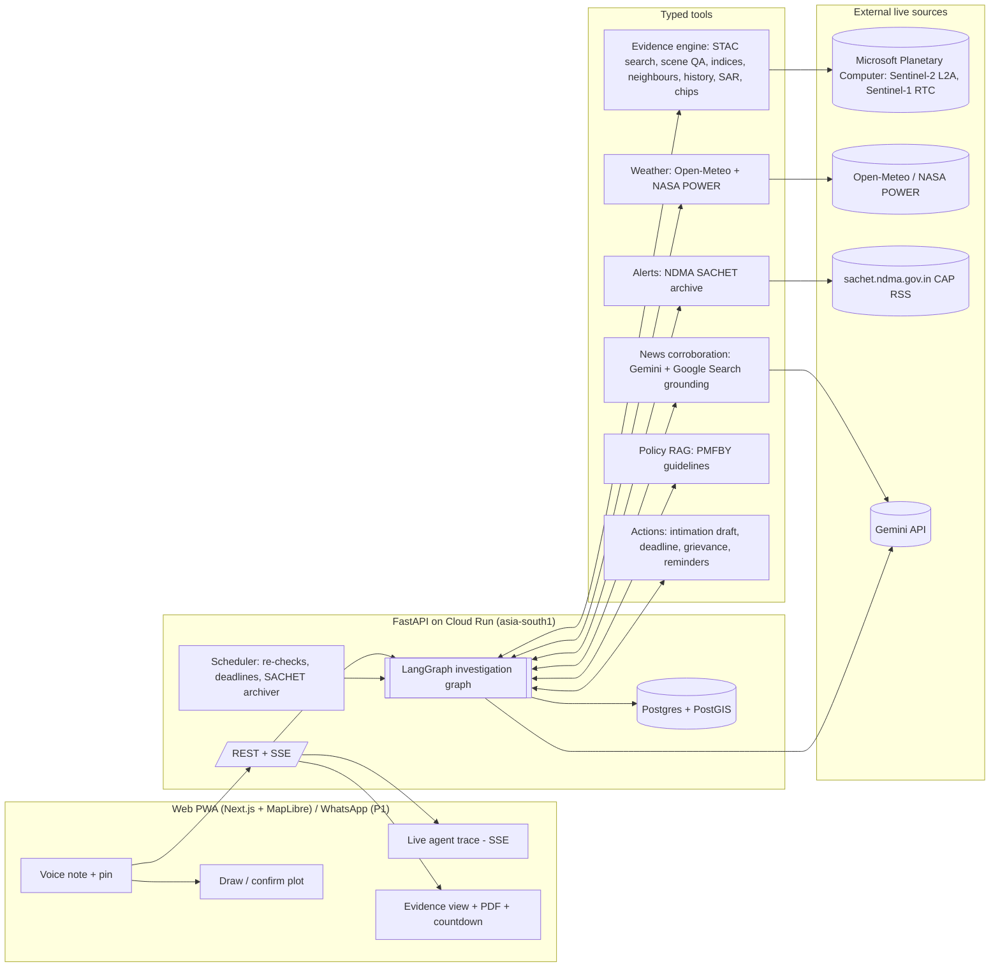
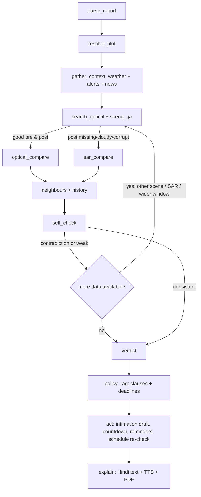

# 02 — Architecture

> **Superseded in part.** This file is an early working draft and some claims here were later corrected against the official guidelines and real data. For current facts see [`docs/submission/facts.md`](../submission/facts.md), and for the current design see [`docs/plan/07-build-contract.md`](07-build-contract.md).

## 1. System diagram



This diagram (or a cleaned-up version) goes into the repo README as the required "architecture diagram".

## 2. Tech stack decisions

These are fixed now to avoid debate later. Change one only with a written reason at a gate.

| Concern | Decision | Why |
|---|---|---|
| Backend language | **Python 3.12** | Geospatial ecosystem (odc-stac, rioxarray) is Python |
| API | **FastAPI** + uvicorn, **SSE** for the live trace | Simple streaming |
| Agent orchestration | **LangGraph** (explicit state graph, conditional edges, checkpointing) | Visible, explainable graph. "Complex state graphs" are named in the rubric. |
| LLM | **Gemini 3.x Pro** for planning/verdict reasoning, **Gemini 3.x Flash** for parsing/translation/fast steps, via the `google-genai` SDK, with structured output (response schema) + function calling | Paid access. **Gemini 2.5 is shut down (Oct 2026), so don't use it.** Confirm the exact model IDs in AI Studio at kickoff. |
| Voice in | Gemini native audio input (webm/ogg upload) → structured JSON | One call does transcription + extraction |
| Voice out | **Gemini TTS, hi-IN** | GA for Hindi |
| Satellite access | **Planetary Computer STAC** (`pystac-client` + `planetary-computer` signing + `odc-stac` + `rioxarray`) | Free, worked in the spike, COGs allow per-plot windowed reads |
| Geometry | `shapely`, `pyproj`; UTM 43N (EPSG:32643) for Haryana/Punjab, but compute the zone dynamically for any pin | Correct areas and buffers |
| Weather | **Open-Meteo** (buy the commercial API key: the shared free tier returned 429) + **NASA POWER** fallback | Hourly precipitation + `weather_code` 96/99 (thunderstorm with hail) as a hail proxy |
| Alerts | NDMA SACHET CAP RSS, **archived by our own job every 15 min from day 1** | The feed only shows *current* alerts. Archiving builds real history going forward. |
| Policy | PMFBY Operational Guidelines PDF (download from pmfby.gov.in at kickoff) → chunked by clause, Gemini embeddings in pgvector, or long-context fallback | Cited clause IDs |
| DB | **Postgres + PostGIS + pgvector** (Supabase) | Spatial queries + vectors + quick hosting |
| Object storage | Supabase Storage (or GCS) | Chips, PDFs, audio |
| PDF | HTML template → **WeasyPrint**, Noto Sans Devanagari font | Hindi rendering |
| Frontend | **Next.js** (App Router) + **MapLibre GL** + **terra-draw** (polygon drawing) + Tailwind | Fast, mobile-friendly |
| Basemap | Esri World Imagery or a Sentinel-2 cloudless mosaic tile service (check terms), plus OSM labels | Farmers recognise their field on imagery |
| Hosting | **Backend: Cloud Run, region asia-south1 (Mumbai)**; **Frontend: Vercel** | Indian region helps reach Indian government sites; Gemini is in the same cloud |
| Scheduler | Cloud Scheduler → `POST /jobs/tick` every 15 min (or APScheduler in-process for the MVP) | Re-checks, deadlines, SACHET archive |
| WhatsApp (P1) | Meta WhatsApp Cloud API test number (up to 5 verified recipients) | Enough for the demo |

## 3. Repository layout

```
/
├── README.md                    # setup, architecture diagram, demo link (submission requirement)
├── backend/
│   ├── app/
│   │   ├── main.py              # FastAPI app, routes, SSE
│   │   ├── config.py            # env vars
│   │   ├── db.py, models.py     # SQLAlchemy/GeoAlchemy2 models
│   │   ├── agent/
│   │   │   ├── graph.py         # LangGraph definition (nodes + edges)
│   │   │   ├── state.py         # CaseState TypedDict
│   │   │   ├── prompts/         # system prompts (versioned)
│   │   │   └── llm.py           # Gemini client wrappers (pro/flash/tts/audio)
│   │   ├── tools/
│   │   │   ├── geo/             # Owner A
│   │   │   │   ├── stac.py      # search + load windows
│   │   │   │   ├── qa.py        # scene radiometric QA
│   │   │   │   ├── indices.py   # NDVI, NDRE, NDMI, BSI
│   │   │   │   ├── compare.py   # pre/post, neighbours, history
│   │   │   │   ├── sar.py       # Sentinel-1 change
│   │   │   │   └── chips.py     # PNG rendering
│   │   │   ├── weather.py, alerts.py, news.py, policy.py, actions.py
│   │   ├── evidence/schema.py   # Pydantic Evidence model (the contract)
│   │   ├── jobs.py              # re-check, deadline, SACHET archive
│   │   └── pdf/                 # templates + renderer
│   ├── tests/                   # unit tests on real recorded responses + live smoke tests
│   └── Dockerfile
├── web/                         # Owner C: Next.js app
├── spikes/                      # feasibility scripts (not used at runtime)
└── docs/                        # ideation + this plan
```

## 4. API contract (agree at H1, then build in parallel)

| Method | Path | Body / params | Returns |
|---|---|---|---|
| POST | `/cases` | `{audio?: file, text?: str, lat, lon, lang: "hi"}` | `{case_id, parsed: {crop, event_type, event_date, claimed_area?}}` |
| PUT | `/cases/{id}/plot` | `{polygon: GeoJSON}` | `{plot_id, area_ha, warnings[]}` |
| POST | `/cases/{id}/investigate` | — | `{run_id}` (starts the graph) |
| GET | `/runs/{run_id}/stream` | SSE | events: `step_started`, `tool_called`, `tool_result`, `decision`, `self_check`, `verdict`, `error` |
| GET | `/cases/{id}` | — | full case + latest `Evidence` + actions + deadlines |
| GET | `/cases/{id}/evidence.pdf` | `lang` | PDF |
| GET | `/cases/{id}/summary.mp3` | `lang` | TTS audio |
| POST | `/cases/{id}/submission` | `{channel, reference_no, submitted_at}` | updated case |
| POST | `/cases/{id}/ask` | `{question, lang}` | cited policy answer |
| POST | `/jobs/tick` | (scheduler auth) | job report |
| POST | `/whatsapp/webhook` | Meta payload | (P1) |

**Owner C builds against real backend responses from H6 onward. Mock servers aren't needed:** the walking skeleton returns real (if minimal) data from day 1.

## 5. The Evidence contract (`evidence/schema.py`), shared by A, B and C

```jsonc
{
  "case_id": "…",
  "plot": {"area_ha": 1.6, "centroid": [75.03, 29.53], "crs": "EPSG:32643"},
  "event": {"type": "hail", "date": "2026-10-25", "date_source": "farmer"},
  "optical": {
    "scenes_considered": [{"id": "S2B_MSIL2A_20261028…", "date": "2026-10-28", "qa": "rejected", "qa_reasons": ["NIR band missing/invalid", "context NDVI collapse"]}],
    "pre":  {"scene_id": "…", "date": "2026-10-18", "valid_frac": 0.99, "ndvi_median": 0.71, "ndvi_p25": 0.66},
    "post": {"scene_id": "…", "date": "…", "valid_frac": 0.95, "ndvi_median": 0.48, "ndvi_p25": 0.39},
    "plot_delta_ndvi": -0.23,
    "within_plot_pattern": "patchy" ,           // patchy | uniform | none
    "post_bare_fraction": 0.06
  },
  "neighbours": {"ring_m": [300, 1500], "n_pixels": 5120, "delta_ndvi_median": -0.05, "plot_percentile": 94},
  "history": {"years": [2024, 2025], "same_window_delta_ndvi": [-0.08, -0.09]},
  "sar": {"pair": ["2026-10-16", "2026-10-28"], "orbit": "ascending", "vh_change_db": -1.9, "water_frac_post": 0.0},
  "weather": {"precip_mm_event_window": 23.4, "hail_code_hours": 2, "source": "open-meteo", "fetched_at": "…"},
  "alerts": [{"source": "SACHET", "id": "…", "issued": "…", "text": "…"}],
  "news": [{"title": "…", "url": "…", "date": "2026-10-25"}],
  "verdict": {
    "level": "strong|moderate|weak|insufficient|not_damage_likely_harvest",
    "reasons": ["…"], "caveats": ["…"],
    "falsifiers_checked": ["harvest", "cloud_shadow", "corrupted_scene"]
  },
  "policy": [{"clause_id": "…", "text": "…", "applies_because": "…"}],
  "deadlines": [{"type": "intimation_72h", "due_at": "…", "basis": "clause …"}],
  "provenance": [{"field": "optical.post.ndvi_median", "source": "planetary-computer", "asset": "…", "retrieved_at": "…"}]
}
```

*(Numbers above only illustrate types. Nothing in the app may ship with fixture values.)*

## 6. Data model (Postgres)

| Table | Key columns |
|---|---|
| `users` | id, name, phone (opt), lang, created_at |
| `cases` | id, user_id, crop, event_type, event_date, status (`open`/`intimation_due`/`submitted`/`rechecking`/`closed`), created_at |
| `plots` | id, case_id, geom (Polygon, 4326), area_ha, source (`drawn`/`suggested`) |
| `runs` | id, case_id, started_at, finished_at, trigger (`user`/`scheduler`), status |
| `run_events` | id, run_id, seq, type, payload JSONB, ts (powers the trace replay) |
| `evidence` | id, run_id, case_id, json JSONB, verdict_level, created_at |
| `actions` | id, case_id, type (`intimation_draft`/`submission`/`grievance_draft`/`reminder`), payload, status, due_at |
| `scene_cache` | scene_id, collection, bbox, qa_status, qa_reasons, checked_at (avoid re-QA) |
| `alerts_archive` | id, identifier, sent, area_desc, polygon/geocode, raw_xml, fetched_at |
| `policy_chunks` | id, doc, clause_id, text, embedding vector |

## 7. Agent graph (LangGraph)



- **Deterministic numerics, LLM reasoning:** all numbers come from tools (Owner A's code). Gemini decides *which tool next*, interprets the signals against the rubric, writes explanations, and must cite fields from the Evidence JSON. A validator rejects any explanation containing a number not present in the evidence (regex check on digits vs. evidence values).
- **Budget:** max 12 tool calls per run, 90 s soft timeout. Each tool has its own timeout and retry (2× with backoff).
- **Self-check rules** (also enforced in code, not only in the prompt): see [03 §8](03-evidence-engine.md#8-self-check-falsifiers).

## 8. Gemini usage map

| Step | Model | Mode |
|---|---|---|
| parse_report (audio → JSON) | Flash | audio input + response schema |
| planner / tool selection | Pro | function calling |
| news corroboration (P1) | Flash or Pro | Google Search grounding (billed per executed query on 3.x: cache per event × district) |
| verdict narrative | Pro | structured output, citing evidence fields |
| policy Q&A | Flash | RAG context, must cite clause IDs |
| Hindi summary text | Flash | from a fixed template; numbers inserted by code |
| TTS | Gemini TTS | hi-IN |
| visual second opinion (P2) | Pro | image input of chips, flagged as "advisory" |

## 9. Environment variables

`GEMINI_API_KEY`, `GEMINI_MODEL_PRO`, `GEMINI_MODEL_FLASH`, `GEMINI_MODEL_TTS`, `DATABASE_URL`, `STORAGE_BUCKET`, `OPEN_METEO_API_KEY`, `PC_SDK_SUBSCRIPTION_KEY` (optional, longer-lived Planetary Computer tokens), `SCHEDULER_TOKEN`, `WHATSAPP_TOKEN`/`WHATSAPP_PHONE_ID`/`WHATSAPP_VERIFY_TOKEN` (P1), `PUBLIC_WEB_URL`.

## 10. Performance targets

| Step | Target |
|---|---|
| Voice parse | < 5 s |
| Optical search + QA + pre/post stats for a ≤ 10 ha plot | < 25 s (windowed COG reads at 10 m, plus a 1.5 km context at 20 m) |
| Neighbour + history (2 years) | < 20 s, run in parallel with SAR |
| Full investigation | **< 75 s**, streamed so the user always sees progress |
| Cache | Scene QA results and per-scene context stats are cached by scene ID, so repeat runs are fast |
